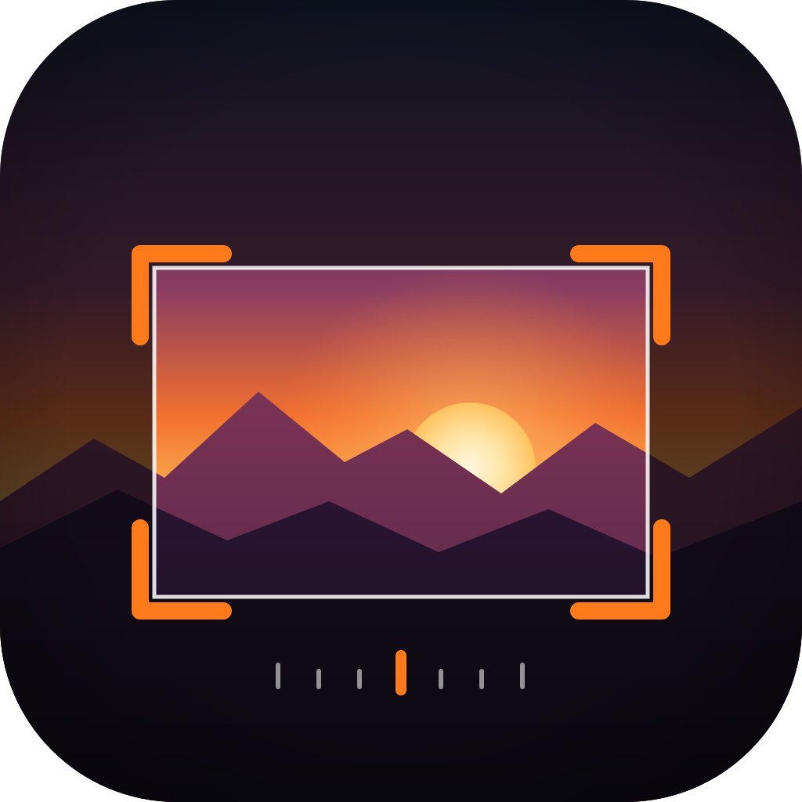

# PhotoViewfinder

A director's-viewfinder app for iPhone: pick a capture format (full frame, APS-C, MFT, medium format, 6×7, XPan, 4×5…) and a focal length, and the live camera shows exactly what that lens would frame — with the surroundings dimmed around it so you can see what's just outside the shot.

## Features

- Frame lines for 10 formats, each with its own common focal-length presets
- Logarithmic focal-length slider, preset chips, and pinch-to-change on the viewfinder
- Switching format keeps the same angle of view (35mm FF → 23mm APS-C)
- Readouts: full-frame equivalent, crop factor, horizontal/vertical/diagonal angle of view
- Surroundings mode (frame fills 78%) or fill mode (double-tap to toggle)
- Frame follows how you hold the phone (portrait/landscape), labels rotate via the gyro, even with rotation lock on; a rotate button forces the other orientation
- Shutter saves the framed crop to Photos, optionally captioned with lens + format
- Field-of-view calibration in Settings, plus camera diagnostics

## How it works

iOS reports the back camera's field of view (`AVCaptureDevice.Format.videoFieldOfView`). The app uses the virtual multi-lens camera (ultra-wide → wide → tele, switched automatically by zoom factor), so at zoom 1 it sees the widest view. For a chosen format `W×H` mm and focal length `F`, the frame covers `(W/2F) / tan(fov/2)` of the sensor's long side (similarly for the short side). The app sets the camera zoom so that frame occupies a comfortable part of the screen, then draws the frame from the *actual* zoom, so what you see is always geometrically right. If you ask for something wider than the ultra-wide (≈13mm FF), you get a warning.

## Building (on the Mac)

Development happens on any machine; building and installing needs a Mac with Xcode 15+ and an iPhone on iOS 17+.

```sh
brew install xcodegen      # once
xcodegen generate          # creates PhotoViewfinder.xcodeproj from project.yml
open PhotoViewfinder.xcodeproj
```

Free Apple ID (7-day) signing:

1. Xcode → Settings → Accounts → add your Apple ID (creates a "Personal Team").
2. Target → Signing & Capabilities → pick that team. To keep it across `xcodegen generate` runs, put the team ID in `DEVELOPMENT_TEAM` in `project.yml`.
3. If the bundle ID is taken, change `PRODUCT_BUNDLE_IDENTIFIER` in `project.yml`.
4. Plug in the iPhone, enable Developer Mode (Settings → Privacy & Security), choose it as run destination, ⌘R.
5. First launch: trust the developer on the phone (Settings → General → VPN & Device Management).

The app stops launching after 7 days; just build and run again from Xcode to re-sign.

`PhotoViewfinder.xcodeproj` and `Info.plist` are generated, so don't commit them. Re-run `xcodegen generate` after adding or removing files.

## Project layout

| File | Purpose |
| --- | --- |
| `project.yml` | XcodeGen spec (targets, Info.plist keys, signing) |
| `FilmFormat.swift` | Format sizes, presets, crop factor, angle of view |
| `ViewfinderMath.swift` | Maps format + focal length onto the phone sensor/screen; picks zoom |
| `CameraController.swift` | AVCaptureSession, lens choice, zoom, photo capture |
| `CameraPreview.swift` | Preview layer wrapped for SwiftUI |
| `FrameOverlay.swift` | Mask, frame lines, corner marks, grid |
| `OrientationMonitor.swift` | CoreMotion-based orientation for labels and saved photos |
| `PhotoComposer.swift` | Crop/orient/caption the capture and save to Photos |
| `ViewfinderView.swift` | Main screen |
| `SettingsView.swift` | Calibration, overlay options, diagnostics |
